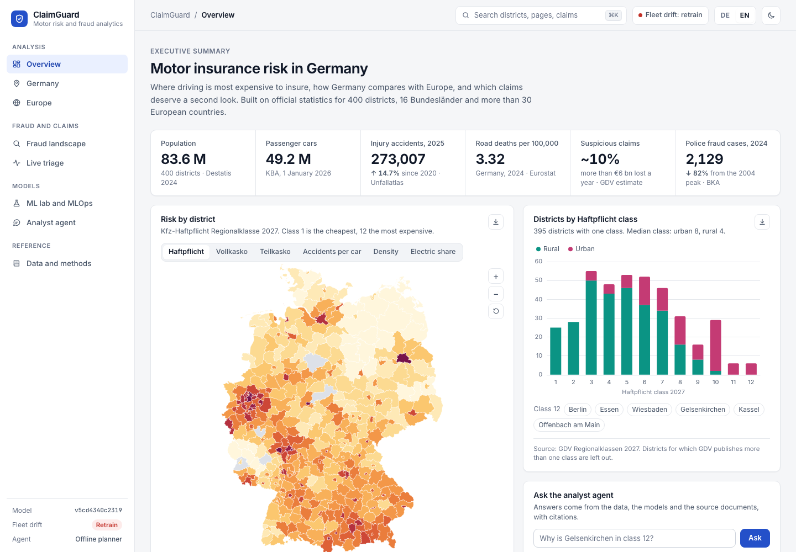

# ClaimGuard Agent

**App:** https://claimguard.138.2.179.154.sslip.io  
**Workflows:** https://n8n.138.2.179.154.sslip.io

German and European motor-insurance risk, fraud triage, and the four jobs that keep the models honest. The app is public. The workflow site is the n8n instance that runs those jobs. After sign-in, the workflows page shows how the published statistics, the tables, the two models, the site and the four jobs connect.

## Skills and tools

| area | what is used |
|---|---|
| Data analysis | Python, pandas, NumPy, SciPy, SQLite, pyshp, Shapely. Public tables from GDV, Destatis, KBA, Eurostat, EIOPA and BKA |
| Machine learning | scikit-learn: HistGradientBoosting, Ridge, a median baseline, IsolationForest, GroupKFold by Bundesland, permutation importance, partial dependence |
| MLOps | Data contracts, a quality gate, a versioned model registry, PSI drift, weekly retrain, GitHub Actions, pytest, Ruff |
| Retrieval | BM25 over the methodology notes, pypdf for the source documents, citations in the agent |
| Agent | FastAPI tool API, a planner that calls the tools, an offline fallback when no LLM key is set |
| Interface | HTML, CSS and JavaScript. No framework. ECharts, self-hosted fonts, German and English, light and dark |
| Automation | n8n: claim intake, app events, weekly drift, daily red-queue digest |
| Delivery | Docker, Docker Compose, Caddy, Oracle Cloud |



## What it answers

1. **Where in Germany is driving most expensive to insure, and why?** 400 districts, GDV Regionalklassen 2027 (Haftpflicht, Vollkasko, Teilkasko), Unfallatlas accidents 2020–2025, the KBA vehicle stock and population.
2. **Can public data reproduce the GDV classes?** The model is tested on Bundesländer it never saw in training. The residuals show where a class sits above what public data explains.
3. **How does Germany compare in Europe?** Road deaths, claims ratios and fraud figures from Eurostat, EIOPA and national fraud bodies.
4. **How would a claims department triage fraud?** Ten transparent rules give a green, amber or red band. An IsolationForest is a second opinion. The inbox is a live stream with investigator briefs.

## Key findings

Computed from the data. The write-up is `claimguard/reports/analysis.md`.

| | finding |
|---|---|
| Density drives the class | Spearman ρ = 0.74 between population density and Haftpflicht class, against 0.27 for accidents per car. Median class: urban 8, rural 4. |
| Rural crashes are worse | 21% of rural injury accidents are serious or fatal, against 13% in cities. |
| States | Berlin's average class is 12.0. Mecklenburg-Vorpommern's is 1.3. |
| Trend | Injury accidents rose 14.7% from 2020 to 2025. |
| Spatial leakage | A random split shows MAE 1.08. On unseen Bundesländer it is 1.50, so a random split flatters the model by 39%. |
| Priced gaps | Bayern sits on average 2.0 classes above what the model predicts. Kempten is +5.7 and Oberallgäu is +5.2. |
| Fleet drift | KBA 2025 to 2026: hybrid share PSI 1.33, so the drift status is **retrain**. |
| Europe | Germany has 3.32 road deaths per 100k (rank 23 of 33). Its non-life claims ratio is 61% against a median of 59% across 30 countries. |
| Fraud | Police-recorded insurance fraud fell to 2,129 cases, 82% below the 2004 peak. |

## Layout

```
claimguard/     the product: API, models, site, workflows, tests
  app/          API, agent and tools
  core/         scoring
  pipeline/     marts, data contracts, report, map
  ml/           Regionalklasse, anomaly model, drift, registry
  rag/          retrieval over the source notes
  web/          HTML, CSS and JS. No framework and no build step
  n8n/          four workflows, and the picture on the workflows page
  data/         the tables, the map and the retrieval index the app serves
  docs/         deploy guide and screenshots
analysis/       district, Europe, fraud and simulated-claim tables
build_*.py      how the long table and the analysis tables are built
```

The long source table (`motor_insurance_risk_raw.csv`, about 151 MB), the original `Dataset` archives and the source `PDFs/` stay on disk beside this project. GitHub refuses a single file over 100 MB, and the official PDFs stay with the person who downloaded them. Nothing in those files was rewritten. The tables the live app serves are already in `claimguard/data/`.

## The live app

Plain HTML, CSS and JavaScript. Fonts and charts are served by the app itself. German and English. Light and dark. Haftpflicht, Vollkasko, Teilkasko and Regionalklasse keep their official names.

| view | what is on it |
|---|---|
| Overview | Risk map, class distribution, the computed findings |
| Germany | District map, why a class is high, state ranking, explorer |
| Europe | Road deaths, cars, claims ratios, premiums |
| Fraud landscape | National sources, police fraud since 1993, the ten rules |
| Live triage | Claim stream, queue, scoring, investigator brief |
| ML lab | Spatial against random validation, residuals, drift, registry |
| Analyst agent | Plan, tool calls and cited sources |
| How it connects | Sources, tables, models, the site and the four jobs |
| Data and methods | What is real, what is simulated, how the numbers are made |

Real claim-level data is confidential. The 800 inbox claims are labelled `SIMULATED`.

## Workflows

https://n8n.138.2.179.154.sslip.io

1. **Claim intake.** A webhook scores the claim. Red or second-look claims get an investigator brief.
2. **App events.** The API pushes flagged claims.
3. **Weekly drift.** Monday 07:00. If the status is retrain, it can trigger a new training run.
4. **Daily red-queue digest.**

## Run it

```bash
cd claimguard
make setup && make train && make serve          # http://localhost:8000
```

Docker, from `claimguard/`:

```bash
cp .env.example .env
docker compose up -d --build                    # http://localhost
```

The Oracle deploy notes are in [claimguard/docs/DEPLOY_ORACLE.md](claimguard/docs/DEPLOY_ORACLE.md). The running site is https://claimguard.138.2.179.154.sslip.io and the workflows are https://n8n.138.2.179.154.sslip.io.

The longer product notes, the model gate and the API list are in [claimguard/README.md](claimguard/README.md).
