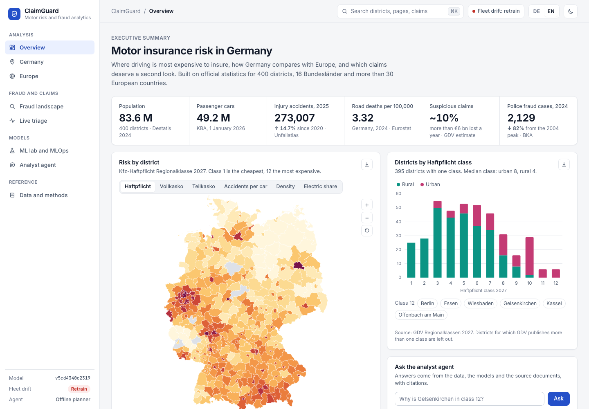
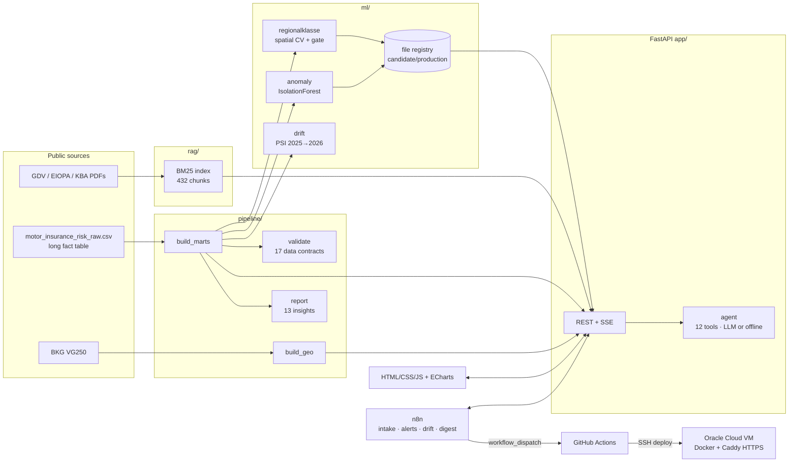
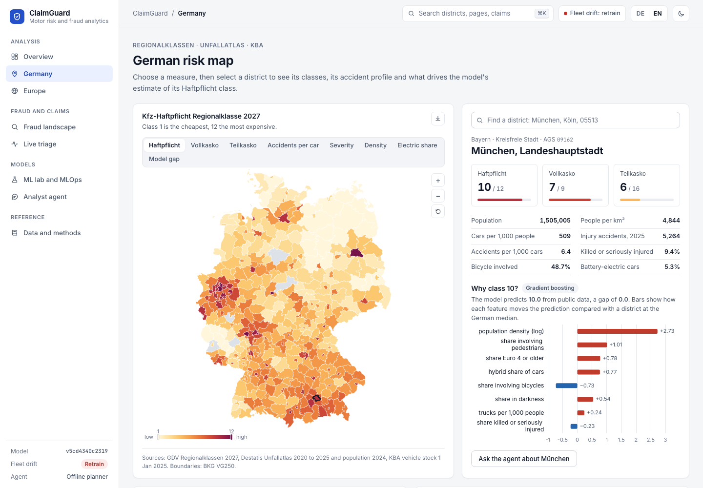
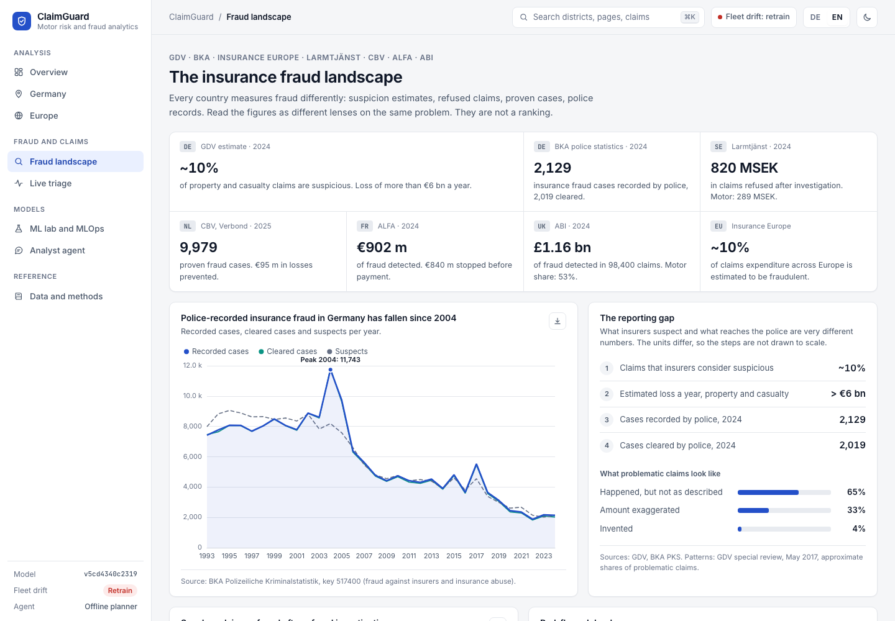
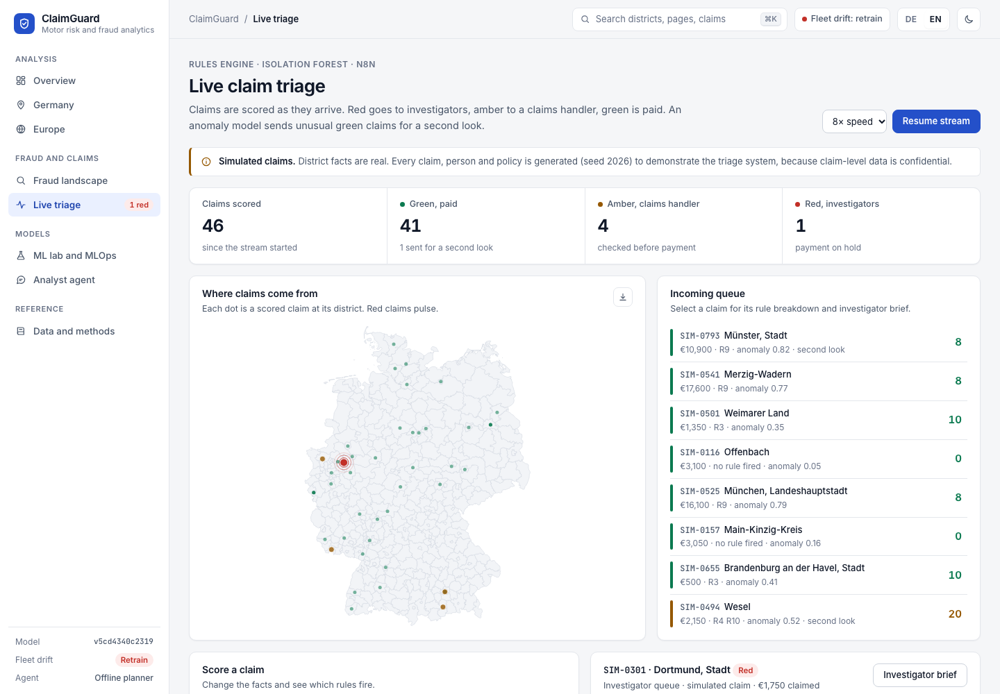
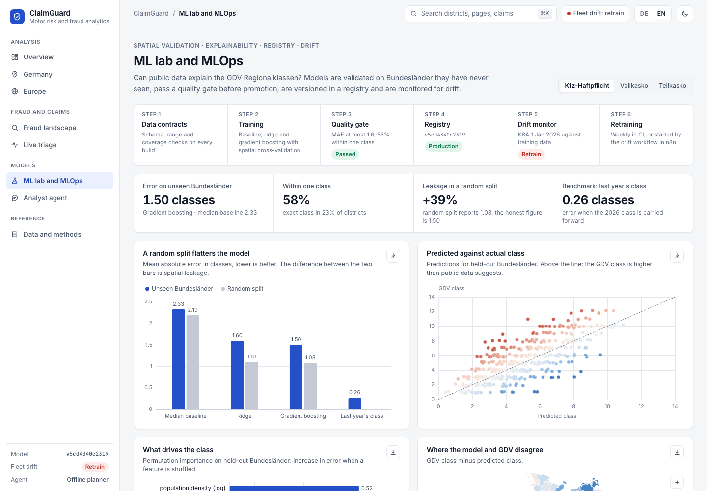
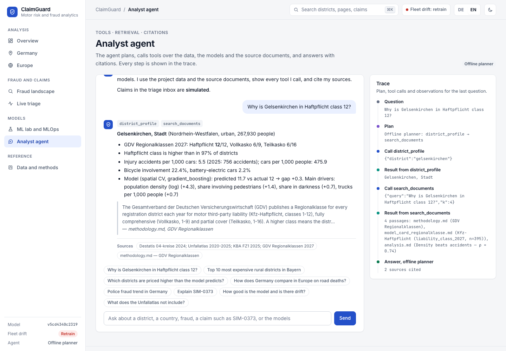
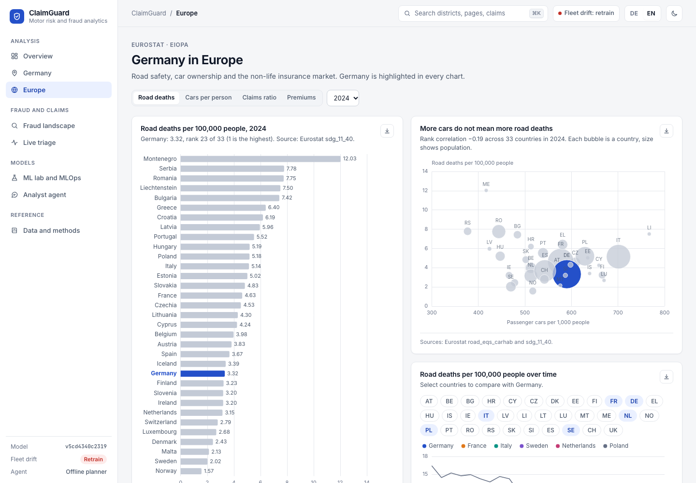
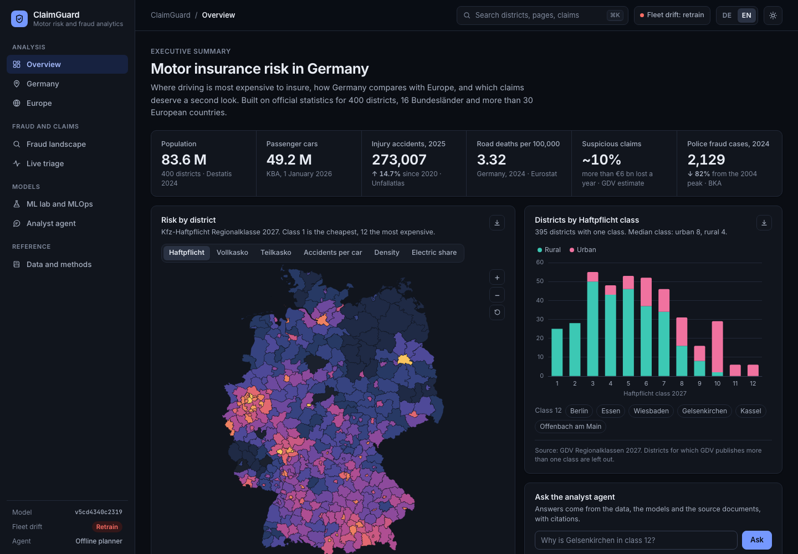
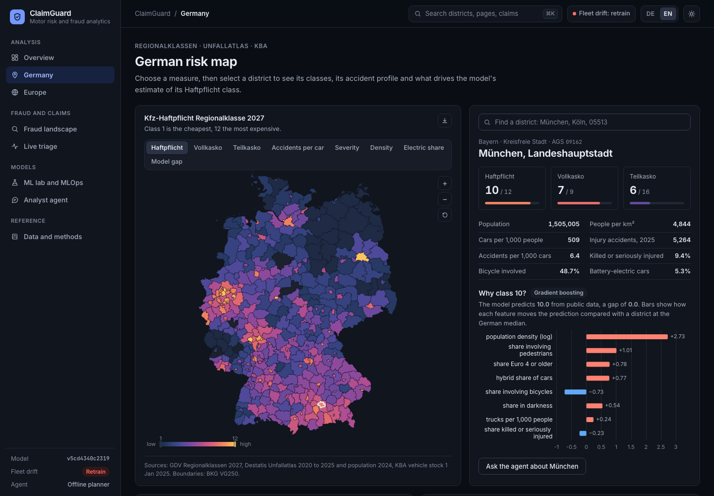

# ClaimGuard

**App:** https://claimguard.138.2.179.154.sslip.io  
**Workflows:** https://n8n.138.2.179.154.sslip.io

German and European motor-insurance risk, fraud triage, and the four jobs that keep the models honest. The app is public. The workflow site is the n8n instance that runs those jobs; the picture of how the system connects sits on the workflows page.

Built on public German and European data: data engineering, expert analysis, machine learning checked the way a German insurer would, MLOps with CI, retrieval over the source documents, an agent that uses tools, n8n, and a plain HTML/JS dashboard in Docker.



## What it answers

1. **Where in Germany is driving most expensive to insure, and why?** It compares 400 districts on GDV Regionalklassen 2027 (Haftpflicht, Vollkasko and Teilkasko) with Unfallatlas accidents 2020–2025, the KBA vehicle stock and population.
2. **Can public data reproduce the GDV classes?** The model is validated on Bundesländer it never saw during training. Its residuals show where classes sit above what public data explains.
3. **How does Germany compare in Europe?** Road deaths, claims ratios and fraud figures from Eurostat, EIOPA and national fraud bodies.
4. **How would a claims department triage fraud?** Ten transparent rules give a green/amber/red band, and an IsolationForest flags unusual claims as a second opinion. It runs as a live stream with investigator briefs.

## Key findings (computed from the data; see `reports/analysis.md`)

| | finding |
|---|---|
| Density drives the class | Spearman ρ = 0.74 between population density and Haftpflicht class, against 0.27 for accidents per car. Median class: urban 8, rural 4. |
| Rural crashes are worse | 21% of rural injury accidents are serious or fatal, against 13% in cities. |
| States | Berlin's average class is 12.0 and Mecklenburg-Vorpommern's is 1.3. |
| Trend | Injury accidents rose 14.7% from 2020 to 2025. |
| Spatial leakage | A random split shows MAE 1.08; on unseen Bundesländer it is 1.50, so a random split flatters the model by 39%. |
| Priced gaps | Bayern sits on average 2.0 classes above what the model predicts; Kempten +5.7 and Oberallgäu +5.2. |
| Fleet drift | KBA 2025 → 2026: hybrid share PSI 1.33, so the drift status is **retrain**. |
| Europe | Germany has 3.32 road deaths per 100k (rank 23 of 33); its non-life claims ratio is 61% against a median of 59% across 30 countries (EIOPA, all non-life business). |
| Fraud | Police-recorded insurance fraud fell to 2,129 cases, 82% below the 2004 peak. Swedish refused motor claims rose 80% from 2020 to 2024. |

## Real vs simulated

**Real (public sources):** Destatis Unfallatlas and population, KBA FZ1/FZ3 vehicle stock, GDV Regionalklassen 2026/2027, Eurostat road safety, EIOPA insurance statistics, BKA PKS, GDV/Insurance Europe/IFB/Larmtjänst fraud figures, and BKG VG250 boundaries. Every number in the dashboard comes from these.

**Simulated (labelled `SIMULATED` everywhere):** the 800 claims in the triage inbox and the live stream. Real claim-level data is confidential. The rules are public red-flag patterns, and the amounts and districts are drawn so the stream looks realistic. The anomaly model is a second opinion, not a fraud classifier, because training on rule-derived labels would be circular.

## Architecture



## The app

Eight views in plain HTML, CSS and JavaScript with vendored ECharts. There is no framework and no build step, and the page makes no third-party requests: fonts (Inter, JetBrains Mono) and the chart library are served from `web/vendor/`.

| view | what is on it |
|---|---|
| Overview | KPI strip, district risk map, distribution of districts by class, the 13 computed findings with a category filter, a shortcut to the agent |
| Germany | District choropleth (8 measures incl. model gap), district panel with a "why is this class high" explanation, density scatter, state ranking, accident profiles, and a sortable district explorer with CSV export |
| Europe | Road deaths, cars per person, non-life claims ratios and premiums by country and year, cars against road deaths, country time series, Germany highlighted |
| Fraud landscape | One card per national source, police fraud since 1993, the reporting gap, refused motor claims in Sweden, the ten red-flag rules |
| Live triage | SSE claim stream on a map, queue with bands, claim scoring form, rule breakdown and investigator brief |
| ML lab and MLOps | Pipeline status (contracts, training, gate, registry, drift, retraining), spatial against random CV, predicted against actual, importance, residual map, partial dependence, drift, registry |
| Analyst agent | Chat that shows its plan, tool calls and cited sources |
| How it connects | A still spatial view of sources, tables, models, the site and the four jobs. Drag to turn, scroll to zoom, click a symbol |
| Data and methods | Sources, what is real and what is simulated, how the numbers are produced, limits, glossary of German terms |

Interface:

- German and English. The choice follows `?lang=`, then the saved choice, then the browser language. Haftpflicht, Vollkasko, Teilkasko and Regionalklasse stay in their official names.
- Light and dark themes. The choice follows the operating system until the toggle is used, then it is remembered.
- Command palette (`Ctrl`/`⌘` + `K`, or `/`): jump to a page, a district (umlauts optional, `koln` finds Köln) or a claim, or send the text to the agent.
- Shareable links: `#germany/05315` opens Köln, `#triage/SIM-0373` opens a claim.
- Every chart exports to PNG; the district explorer exports the filtered table to CSV.
- Responsive down to phone width, keyboard focus styles, reduced-motion support.

| | |
|---|---|
|  |  |
|  |  |
|  |  |
|  |  |

`scripts/ui_smoke.py` drives headless Chrome through every view, the palette, the district explorer, the live stream, the claim form, the agent, the dark theme and a phone-sized window. It fails on any JavaScript error, third-party request or horizontal overflow, and it writes the screenshots above:

```bash
make serve &                                                     # http://localhost:8000
.venv/bin/python scripts/ui_smoke.py http://localhost:8000 docs/screenshots
```

## ML and MLOps

- **Target:** GDV Regionalklasse 2027 for each line. Models: median baseline, Ridge and HistGradientBoosting.
- **Validation:** `GroupKFold` by Bundesland. Neighbouring districts share risk, so a random split leaks information. Both splits are reported to make the leak visible.
- **Explainability:** permutation importance on held-out states, partial dependence, and per-district ablation against median values.
- **Gate** (`configs/regionalklasse.json`): it must beat the baseline by at least 15% MAE, with liability MAE ≤ 1.6 and at least 55% within ±1. A candidate is promoted only if it is not worse than production. The 55% threshold was recalibrated from a first guess of 60%. The first model reached 58%, so the gate is set as a regression guard just below the measured level, and the `_note` in the config says so.
- **Registry:** content-hashed versions (data + config) with stages candidate, production and archived, plus a model card.
- **Drift:** PSI of the fleet features, KBA 2025 against 2026. Thresholds: 0.10 watch, 0.25 retrain.
- **CI** (`.github/workflows/ci.yml`): ruff → data contracts → train + gate → anomaly → drift → report → 78 tests → Docker build + smoke test → SSH deploy. It also runs weekly and can be triggered by n8n.
- **The honest benchmark:** last year's GDV class predicts this year's with MAE 0.26. The public-data model (1.50) is not meant to replace GDV. It explains the classes and finds areas where they are mispriced relative to public risk.

## Layout

```
app/         API, agent and tools
core/        scoring and shared logic
pipeline/    marts, data contracts, report, map
ml/          Regionalklasse, anomaly model, drift, registry
rag/         retrieval index and source notes
web/         HTML, CSS and JS, no build step
n8n/         the four workflows, plus the picture injected on the workflows page
configs/     the model quality gate
data/        marts, district map and retrieval index
docs/        deploy guide and screenshots
tests/       contracts, models, API, agent
scripts/     UI smoke test
reports/     the written findings
```

This folder is the product. Beside it, in the same repository, are `analysis/` (the district, Europe, fraud and simulated-claim tables) and the `build_*.py` scripts that assembled them. The long source table (`motor_insurance_risk_raw.csv`, about 151 MB), the original Dataset archives and the source PDFs stay on disk next to the repository. GitHub refuses a single file over 100 MB. The tables the app serves are already in `data/`. Rebuilding them needs those local files (`make data`).

## n8n workflows (`n8n/workflows/`)

Open them at https://n8n.138.2.179.154.sslip.io

1. **Claim intake → triage → investigator alert.** A webhook scores the claim and replies; red or second-look claims get an agent brief, which is sent to the alert channel.
2. **App events.** The API pushes flagged claims, which are briefed and alerted.
3. **Weekly drift report.** Monday 07:00: drift check, an agent summary and a report. If the status is retrain, it triggers GitHub Actions.
4. **Daily red-queue digest.**

## Run it

```bash
# local
make setup && make train && make serve          # http://localhost:8000

# docker: app + n8n + Caddy
cp .env.example .env && docker compose up -d --build   # http://localhost, n8n on :8080
```

Deploy to Oracle Cloud: [docs/DEPLOY_ORACLE.md](docs/DEPLOY_ORACLE.md).

**Agent LLM:** set `LLM_BASE_URL`, `LLM_API_KEY` and `LLM_MODEL` for any OpenAI-compatible endpoint (OpenAI, Groq, Ollama via `--profile llm`). Without them the agent uses its deterministic offline planner, which still calls the same tools and cites sources.

## API (selection)

`/api/overview` · `/api/insights` · `/api/districts/{code}` · `/api/districts/{code}/explain` · `/api/states` · `/api/europe?year=` · `/api/fraud/landscape` · `/api/fraud/police` · `POST /api/claims/score` · `/api/claims/stream/live` (SSE) · `/api/ml/regionalklasse` · `/api/ml/registry` · `/api/ml/drift` · `/api/rag/search?q=` · `POST /api/agent/chat` (SSE) · `POST /api/agent/brief` · interactive docs at `/docs`.

## Talking points for German insurers

- **Tarifierung / Regionalklassen:** you know how GDV classes are made (claims experience per Zulassungsbezirk) and why public injury-accident data explains only part of them.
- **Validation:** spatial cross-validation and leakage. The question "would this model work in a Bundesland it has never seen?" matters to actuaries.
- **Explainability and regulation:** transparent rules plus a per-district explanation of each prediction. This fits the BaFin and EU AI Act expectations on explainable pricing and claims decisions.
- **Fraud (Betrugsbekämpfung):** rules first, anomaly detection as a second look, and humans decide. GDV estimates about 10% of claims involve fraud, roughly €6 bn a year.
- **MLOps:** a quality gate, a registry, drift on real fleet changes (the hybrid and BEV share shift) and automated retraining.

## Limits

- The Unfallatlas has injury accidents only; property-damage-only claims, which drive much of Haftpflicht, are missing.
- KBA reports Trier and Trier-Saarburg as one figure, so those districts have no fleet features. Eisenach is merged into Wartburgkreis for consistency.
- The claims are simulated, so the triage metrics describe the system's behaviour, not real fraud detection rates.
- European fraud figures use different national definitions and are shown side by side, not ranked.
